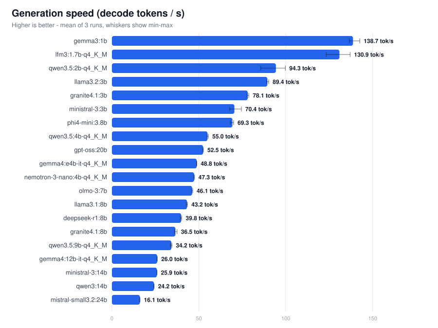
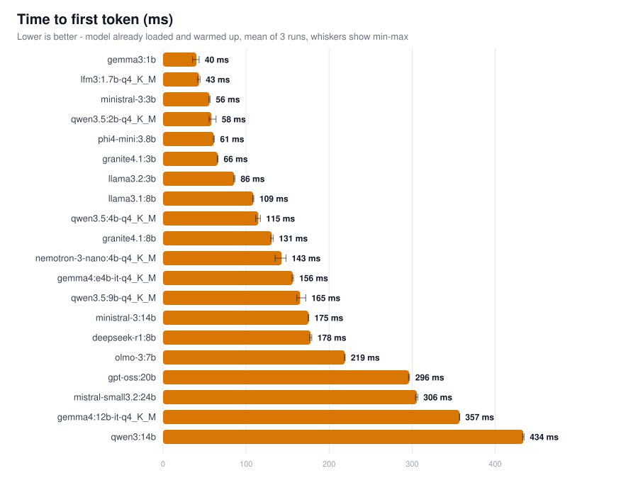
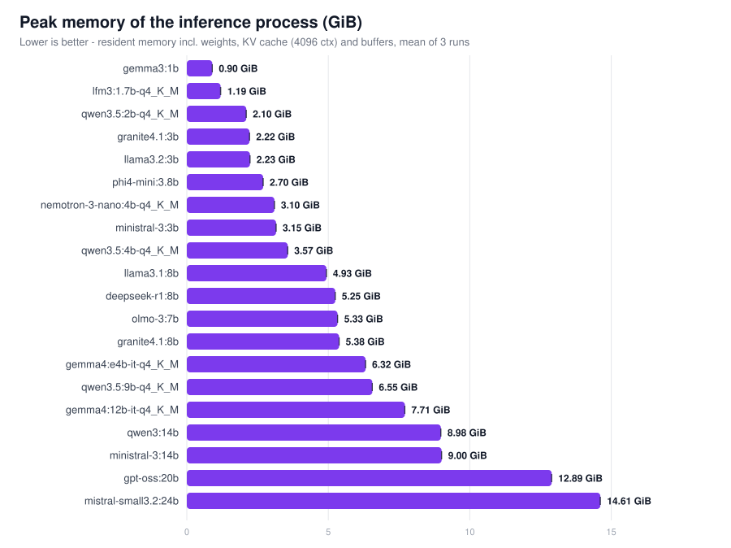
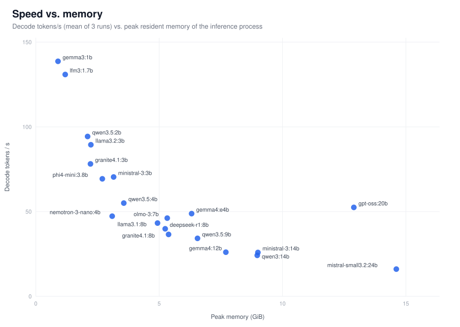
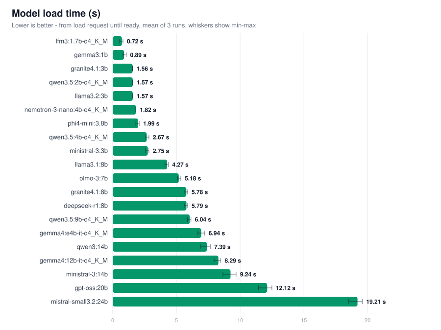

# Local LLM benchmark — Mac mini M4 Pro (12 CPU · 16 GPU · 24 GB · 512 GB)

**20 open-source LLMs from 11 vendors, 1B → 24B parameters, each measured 3 times on the same machine
with the same framework, the same settings and the same prompt — only the model changes.**

Measured: **generation speed (tokens/s)**, **time to first token (TTFT)**, **memory usage** and **load time**.
Full data: [`results/benchmark_results.json`](results/benchmark_results.json) · run date: 2026-11-13

---

## TL;DR

| | Model | Result |
|---|---|---|
| 🏎️ Fastest generation | `gemma3:1b` | **138.7 tok/s** |
| 🧠 Best speed for a big model | `gpt-oss:20b` (21B MoE) | **52.5 tok/s** — faster than every other model with 7B+ parameters |
| ⚡ Lowest time to first token | `gemma3:1b` | **40 ms** |
| 🐘 Largest model tested | `mistral-small3.2:24b` | 16.1 tok/s · 14.6 GiB · Mac peaked at 20.5 of 24 GiB |
| 🎯 Repeatability | all 60 runs | median run-to-run variation **0.9 %** |

- **Every model is fast enough for interactive use**: even the slowest (`mistral-small3.2:24b`, 16 tok/s)
  generates about 3× faster than people read.
- **Once a model is loaded, answers start almost instantly**: TTFT is under 0.5 s for all 20 models and under
  100 ms for 7 of them.
- **Rule of thumb for this Mac (dense models, Q4):** tokens/s ≈ **220 ÷ model file size in GB**
  (8B ≈ 43 tok/s, 14B ≈ 24 tok/s, 24B ≈ 16 tok/s).
- **24 GB is enough for models up to ~24B at Q4**; that is also the ceiling.

---

## The machine

| | |
|---|---|
| Computer | Mac mini 2024 (`Mac16,11`) |
| Chip | Apple M4 Pro — 12-core CPU (8 performance + 4 efficiency), 16-core GPU, 273 GB/s memory bandwidth |
| Memory | 24 GB unified memory (GPU working-set limit reported by Metal: 17.8 GiB) |
| Storage | 512 GB SSD |
| OS | macOS 27.2.1 (26B131) |
| Framework | **Ollama 0.40.16**, llama.cpp engine (`llama-server`, build 12177) for all models, Metal GPU |

---

## Results

| # | Model | Vendor | Params | Quant | Decode tok/s | TTFT (ms) | Prefill tok/s | Load (s) | Peak memory (GiB) | Disk (GiB) |
|--:|---|---|--:|---|--:|--:|--:|--:|--:|--:|
| 1 | `gemma3:1b` | Google | 999.89M | Q4_K_M | **138.7** ± 3.4 | 40 | 841 | 0.89 | 0.90 | 0.75 |
| 2 | `lfm3:1.7b-q4_K_M` | Liquid AI | 1.7B | Q4_K_M | **130.9** ± 7.0 | 43 | 786 | 0.72 | 1.19 | 1.02 |
| 3 | `qwen3.5:2b-q4_K_M` | Alibaba (Qwen) | 1.9B | Q4_K_M | **94.3** ± 7.6 | 58 | 603 | 1.57 | 2.10 | 1.81 |
| 4 | `llama3.2:3b` | Meta | 3.2B | Q4_K_M | **89.4** ± 0.7 | 86 | 524 | 1.57 | 2.23 | 1.88 |
| 5 | `granite4.1:3b` | IBM | 3.4B | Q4_K_M | **78.1** ± 0.6 | 66 | 497 | 1.56 | 2.22 | 1.96 |
| 6 | `ministral-3:3b` | Mistral AI | 3.8B | Q4_K_M | **70.4** ± 3.6 | 56 | 458 | 2.75 | 3.15 | 2.75 |
| 7 | `phi4-mini:3.8b` | Microsoft | 3.8B | Q4_K_M | **69.3** ± 1.1 | 61 | 368 | 1.99 | 2.70 | 2.32 |
| 8 | `qwen3.5:4b-q4_K_M` | Alibaba (Qwen) | 4.2B | Q4_K_M | **55.0** ± 0.4 | 115 | 312 | 2.67 | 3.57 | 3.1 |
| 9 | `gpt-oss:20b` | OpenAI | 20.9B | MXFP4 | **52.5** ± 0.3 | 296 | 394 | 12.12 | 12.89 | 12.85 |
| 10 | `gemma4:e4b-it-q4_K_M` | Google | 7.5B | Q4_K_M | **48.8** ± 0.0 | 156 | 388 | 6.94 | 6.32 | 6.13 |
| 11 | `nemotron-3-nano:4b-q4_K_M` | NVIDIA | 4.0B | Q4_K_M | **47.3** ± 0.2 | 143 | 266 | 1.82 | 3.10 | 2.64 |
| 12 | `olmo-3:7b` | Allen Institute for AI (Ai2) | 7.3B | Q4_K_M | **46.1** ± 0.3 | 219 | 229 | 5.18 | 5.33 | 4.16 |
| 13 | `llama3.1:8b` | Meta | 8.0B | Q4_K_M | **43.2** ± 0.4 | 109 | 315 | 4.27 | 4.93 | 4.58 |
| 14 | `deepseek-r1:8b` | DeepSeek | 8.2B | Q4_K_M | **39.8** ± 0.5 | 178 | 197 | 5.79 | 5.25 | 4.87 |
| 15 | `granite4.1:8b` | IBM | 8.8B | Q4_K_M | **36.5** ± 0.8 | 131 | 248 | 5.78 | 5.38 | 4.98 |
| 16 | `qwen3.5:9b-q4_K_M` | Alibaba (Qwen) | 9.0B | Q4_K_M | **34.2** ± 0.5 | 165 | 210 | 6.04 | 6.55 | 6.1 |
| 17 | `gemma4:12b-it-q4_K_M` | Google | 11.9B | Q4_K_M | **26.0** ± 0.1 | 357 | 141 | 8.29 | 7.71 | 7.47 |
| 18 | `ministral-3:14b` | Mistral AI | 13.9B | Q4_K_M | **25.9** ± 0.1 | 175 | 139 | 9.24 | 9.00 | 8.46 |
| 19 | `qwen3:14b` | Alibaba (Qwen) | 14.8B | Q4_K_M | **24.2** ± 0.2 | 434 | 96 | 7.39 | 8.98 | 8.64 |
| 20 | `mistral-small3.2:24b` | Mistral AI | 24.0B | Q4_K_M | **16.1** ± 0.1 | 306 | 76 | 19.21 | 14.61 | 14.14 |

*Decode tok/s = mean ± standard deviation over 3 runs. TTFT = time to first token with the model already
loaded. Peak memory = peak resident memory of the inference process (weights + KV cache + buffers).
All models ran 100 % on the GPU. Full statistics (median/min/max/stdev for every metric) are in the JSON.*

### Generation speed


### Time to first token


### Memory


### Speed vs. memory


### Load time


<details>
<summary><b>Every individual run (round 1 / round 2 / round 3)</b></summary>

| Model | Decode tok/s | TTFT (ms) | Load (s) | Peak memory (GiB) |
|---|---|---|---|---|
| `gemma3:1b` | 142.6 / 136.6 / 136.8 | 36 / 42 / 44 | 1.06 / 0.81 / 0.81 | 0.90 / 0.90 / 0.90 |
| `lfm3:1.7b-q4_K_M` | 123.3 / 137.1 / 132.3 | 45 / 42 / 44 | 0.55 / 0.81 / 0.81 | 1.20 / 1.19 / 1.19 |
| `qwen3.5:2b-q4_K_M` | 85.6 / 97.5 / 99.8 | 56 / 55 / 64 | 1.57 / 1.58 / 1.57 | 2.10 / 2.10 / 2.10 |
| `llama3.2:3b` | 90.2 / 89.0 / 89.1 | 87 / 85 / 85 | 1.57 / 1.58 / 1.57 | 2.23 / 2.23 / 2.23 |
| `granite4.1:3b` | 78.8 / 77.8 / 77.8 | 66 / 66 / 65 | 1.56 / 1.56 / 1.56 | 2.22 / 2.22 / 2.22 |
| `ministral-3:3b` | 74.5 / 69.1 / 67.7 | 56 / 57 / 55 | 2.58 / 2.84 / 2.84 | 3.16 / 3.15 / 3.15 |
| `phi4-mini:3.8b` | 68.1 / 69.8 / 70.0 | 61 / 62 / 61 | 1.82 / 2.08 / 2.08 | 2.70 / 2.70 / 2.70 |
| `qwen3.5:4b-q4_K_M` | 55.5 / 54.8 / 54.8 | 112 / 116 / 117 | 2.59 / 2.59 / 2.84 | 3.57 / 3.57 / 3.57 |
| `gpt-oss:20b` | 52.1 / 52.7 / 52.7 | 296 / 296 / 297 | 11.43 / 12.49 / 12.44 | 12.89 / 12.89 / 12.89 |
| `gemma4:e4b-it-q4_K_M` | 48.8 / 48.8 / 48.8 | 156 / 156 / 157 | 6.68 / 7.22 / 6.93 | 6.32 / 6.32 / 6.32 |
| `nemotron-3-nano:4b-q4_K_M` | 47.2 / 47.5 / 47.1 | 135 / 145 / 148 | 1.81 / 1.82 / 1.82 | 3.10 / 3.10 / 3.10 |
| `olmo-3:7b` | 45.9 / 46.0 / 46.5 | 219 / 219 / 218 | 5.09 / 5.11 / 5.34 | 5.33 / 5.33 / 5.33 |
| `llama3.1:8b` | 42.8 / 43.5 / 43.5 | 109 / 109 / 108 | 4.09 / 4.36 / 4.35 | 4.93 / 4.93 / 4.93 |
| `deepseek-r1:8b` | 40.2 / 40.0 / 39.3 | 178 / 177 / 179 | 5.61 / 5.88 / 5.86 | 5.25 / 5.25 / 5.25 |
| `granite4.1:8b` | 36.0 / 36.2 / 37.5 | 130 / 133 / 130 | 5.61 / 5.88 / 5.86 | 5.38 / 5.38 / 5.38 |
| `qwen3.5:9b-q4_K_M` | 34.4 / 33.7 / 34.6 | 172 / 161 / 162 | 5.87 / 6.14 / 6.12 | 6.55 / 6.55 / 6.56 |
| `gemma4:12b-it-q4_K_M` | 25.9 / 26.1 / 26.1 | 357 / 357 / 357 | 7.95 / 8.48 / 8.45 | 7.70 / 7.71 / 7.71 |
| `ministral-3:14b` | 25.8 / 25.9 / 25.9 | 176 / 175 / 175 | 8.64 / 9.68 / 9.40 | 9.00 / 9.00 / 9.00 |
| `qwen3:14b` | 24.0 / 24.3 / 24.3 | 434 / 433 / 435 | 6.88 / 7.66 / 7.63 | 8.98 / 8.98 / 8.97 |
| `mistral-small3.2:24b` | 15.9 / 16.2 / 16.2 | 307 / 306 / 304 | 18.50 / 19.58 / 19.54 | 14.62 / 14.62 / 14.61 |

</details>

---

## What the numbers say

**1. Generation speed is limited by memory bandwidth, so model size decides it.**
Generating a token means reading every weight once. For the dense 7B–24B models, *weights × tokens/s* lands at
190–245 GB/s, which is **70–90 % of the M4 Pro's 273 GB/s**. Halving the model size roughly doubles the speed.
Very small models (1–2B) only reach 40–55 % of the bandwidth limit, because fixed per-token overhead takes over.

**2. Mixture-of-Experts is the big win on Apple Silicon.** `gpt-oss:20b` has 21B parameters but only uses 4 of its 32
experts (~3.6B parameters) per token. Result: **52.5 tok/s, 2.2× faster than `qwen3:14b`
and 3.3× faster than `mistral-small3.2:24b`**. The catch is memory: it still needs all weights loaded
(12.9 GiB). So you get the speed of a ~4B model with the memory needs of a ~20B model.

**3. The small hybrid models run below their size class on llama.cpp/Metal.** Models that mix attention
with linear-attention/state-space layers (`qwen3.5:2b`, `qwen3.5:4b`, `nemotron-3-nano:4b`) reach only
44–53 % of the bandwidth limit, against 63–76 % for dense models of similar size (`llama3.2:3b`,
`phi4-mini`, `ministral-3:3b`). For example, `nemotron-3-nano:4b` (2.8 GB) runs at
47 tok/s, while the slightly larger dense `ministral-3:3b` (3.0 GB) runs at
70 tok/s. At 9B the gap closes: `qwen3.5:9b` reaches 71 %, the same as the dense 8B models.

**4. Time to first token is a non-issue on this Mac — for short prompts.** It grows with model size, because
prompt processing is compute-bound. Prefill drops from 841 tok/s
(`gemma3:1b`) to 76 tok/s (`mistral-small3.2:24b`). With this 21–92-token prompt TTFT stays under
half a second; longer prompts take correspondingly longer before the first word (not measured here).
11 of the 20 models reason first by default (`thinking`). Their first token is a reasoning token, so
the first token of the actual *answer* only comes after a few hundred tokens, which takes several seconds.

**5. Memory = download size + a little.** Peak process memory is the model's download size plus up to ~1.2 GiB
(KV cache for 4K context and compute buffers). macOS and the open apps used
5.8 GiB before each load. With `mistral-small3.2:24b` loaded, the Mac peaked at 20.5 GiB of 24 GiB.
No test caused swapping (swap usage stayed flat at 0.38–0.39 GiB, left over from before the run).

**6. Load time scales with size**: from 0.7 s (`lfm3:1.7b`) to 19.2 s (`mistral-small3.2:24b`),
roughly 1 GB/s (0.8–1.2 GB/s) from disk into GPU memory.

**7. The numbers are very repeatable.** Across the 3 rounds, decode speed varied by a median of 0.9 %,
and 15 of 20 models varied by less than 2 %. The biggest spreads are in the tiny, very fast
models, where any background activity on the Mac matters most.

#### Side observations (separate checks, *not* part of the comparison above)
- **Speculative decoding**: Ollama ships Gemma 4 with an MTP draft model and enables it by default. On
  `gemma4:e4b` it raised generation speed from **50.8 to 71.2 tok/s (+40 %)** in a 256-token check.
  It was switched off for the benchmark so that every number reflects the model alone.
- **MLX vs llama.cpp**: on Apple Silicon, Ollama's *default* tags for some new models pull MLX builds
  (NVFP4 quantization, a different engine). In a full 3-round run with those builds, `nemotron-3-nano:4b`
  reached **78.0 tok/s on MLX vs 47.3 tok/s on llama.cpp**, while `lfm3:1.7b` was
  about the same (127.7 vs 130.9). Engine and quantization differ, so these runs were excluded from the
  comparison. Still worth knowing if you use Ollama's default tags.

---

## How the test was run

Everything that is not the model was kept identical — details in [`docs/METHODOLOGY.md`](docs/METHODOLOGY.md).

| Setting | Value (same for every model) |
|---|---|
| Framework / engine | Ollama 0.40.16 → llama.cpp (`llama-server`), Metal, flash attention on, KV cache `q8_0` |
| Weights | GGUF `Q4_K_M` (19 models); `gpt-oss:20b` in its native `MXFP4` (only format it ships in) |
| Prompt | system `You are a helpful assistant.` · user `Explain how a computer CPU works, step by step.` |
| Decoding | greedy (`temperature 0`), `seed 42`, max **512** generated tokens |
| Context | `num_ctx 4096` |
| Speculative decoding | off (`draft_num_predict 0`) |

**Procedure for every single test**

1. unload everything, wait until no runner process is left, 5 s cool-down
2. **load the model** (timed) — the test only starts once the model is fully loaded
3. short warm-up on a different text (not measured) so one-time GPU kernel setup does not distort TTFT
4. **test**: send the prompt (streaming), measure TTFT, tokens/s, memory (sampled every 100 ms)
5. unload

**Order:** round 1 = all 20 models one after another → round 2 = all 20 again → round 3 = all 20 again.
So every model has **3 independent measurements**, never back-to-back. Total: 60 tests, 23 minutes of benchmarking.

---

## Models

| Model (Ollama tag) | Vendor | Parameters | Architecture notes |
|---|---|--:|---|
| `gemma3:1b` | Google | 999.89M | dense transformer |
| `lfm3:1.7b-q4_K_M` | Liquid AI | 1.7B | Liquid LFM hybrid, reasoning |
| `qwen3.5:2b-q4_K_M` | Alibaba (Qwen) | 1.9B | hybrid (linear attention + attention), vision, reasoning |
| `llama3.2:3b` | Meta | 3.2B | dense transformer |
| `granite4.1:3b` | IBM | 3.4B | dense transformer |
| `ministral-3:3b` | Mistral AI | 3.8B | dense transformer, vision |
| `phi4-mini:3.8b` | Microsoft | 3.8B | dense transformer |
| `qwen3.5:4b-q4_K_M` | Alibaba (Qwen) | 4.2B | hybrid (linear attention + attention), vision, reasoning |
| `nemotron-3-nano:4b-q4_K_M` | NVIDIA | 4.0B | hybrid Mamba-Transformer, reasoning |
| `gemma4:e4b-it-q4_K_M` | Google | 7.5B | Gemma 4 "effective 4B" (per-layer embeddings), vision + audio, reasoning |
| `olmo-3:7b` | Allen Institute for AI (Ai2) | 7.3B | dense transformer, fully open (data + code), reasoning |
| `llama3.1:8b` | Meta | 8.0B | dense transformer |
| `deepseek-r1:8b` | DeepSeek | 8.2B | DeepSeek-R1 reasoning distilled into Qwen3-8B |
| `granite4.1:8b` | IBM | 8.8B | dense transformer |
| `qwen3.5:9b-q4_K_M` | Alibaba (Qwen) | 9.0B | hybrid (linear attention + attention), vision, reasoning |
| `gemma4:12b-it-q4_K_M` | Google | 11.9B | dense transformer, vision + audio, reasoning |
| `ministral-3:14b` | Mistral AI | 13.9B | dense transformer, vision |
| `qwen3:14b` | Alibaba (Qwen) | 14.8B | dense transformer, hybrid reasoning |
| `gpt-oss:20b` | OpenAI | 20.9B | Mixture-of-Experts: 32 experts, 4 active per token (~3.6B active), reasoning |
| `mistral-small3.2:24b` | Mistral AI | 24.0B | dense transformer, vision |

**Not included**
- `phi4:14b` (Microsoft) was in the original list, but the llama.cpp build bundled with Ollama 0.40.16 crashes
  while loading it (`ggml_hash_find_or_insert` fatal error, reproducible). Replaced by `ministral-3:14b`.
- `gemma4:26b` — its GGUF `Q4_K_M` is 18 GB, more than the 17.8 GiB the GPU may use on a 24 GB Mac.
  (Ollama's default `gemma4:26b` tag is an MLX/NVFP4 build that runs on a different engine, so it was not
  comparable either.)

---

## Repository layout

| Path | What it is |
|---|---|
| [`results/benchmark_results.json`](results/benchmark_results.json) | **Main result file**: machine info, methodology, rankings, per-model statistics and all 60 runs |
| [`results/raw_runs.jsonl`](results/raw_runs.jsonl) | Raw record of every test (one JSON per line, incl. exact engine command line, memory samples, output preview) |
| [`results/summary.csv`](results/summary.csv) | One row per model — easy to open in Excel / Numbers |
| [`results/tables.md`](results/tables.md) | The tables above |
| [`charts/`](charts) | SVG charts |
| [`docs/METHODOLOGY.md`](docs/METHODOLOGY.md) | Detailed methodology and metric definitions |
| [`bench.py`](bench.py) | The benchmark runner (Python standard library only) |
| [`summarize.py`](summarize.py) | Builds JSON / CSV / tables / charts from the raw runs |
| [`models.txt`](models.txt) · [`pull_models.sh`](pull_models.sh) · [`run_benchmark.sh`](run_benchmark.sh) | Model list, downloader, one-command runner |
| [`logs/bench.log`](logs/bench.log) | Console log of the benchmark run |

## Reproduce

```bash
brew install ollama
# same server settings as this run: start the server with
#   OLLAMA_FLASH_ATTENTION=1 OLLAMA_KV_CACHE_TYPE=q8_0 ollama serve
# (on this Mac they are set in ~/Library/LaunchAgents/sh.brew.ollama.plist for `brew services`)
./run_benchmark.sh          # pulls the models (~101 GiB), runs 3 rounds, writes results/ and charts/
```

The runner is resumable (finished tests are skipped) and refuses to measure a model that Ollama would run on
a different engine than llama.cpp.

---

## Caveats

- **Speed only.** This benchmark does not measure answer quality. A faster model is not a better model.
- **One short prompt, 512 output tokens, 4K context.** Long prompts make TTFT much longer, and long
  conversations make generation somewhat slower (bigger KV cache).
- **Reasoning tokens are counted like any other token.** 11 models think before answering by default.
  Two models stopped before 512 tokens (`granite4.1:3b` at 410, `phi4-mini:3.8b` at 463); tokens/s is not affected.
- **`qwen3.5:2b` round 1** (85.62 tok/s) ran while a chart was being rendered on the Mac.
  Rounds 2 and 3 gave 97.54 and 99.78 tok/s; the median is in the JSON.
- **A normal desktop session**, not a stripped-down machine: other apps were open, using about 5.8 GiB.
- **Load time** depends on whether the model file is still in macOS's file cache (fast) or has to be read from the SSD.
- **Software-specific results.** These are for Ollama 0.40.16 with its llama.cpp engine. Other
  engines (Ollama's MLX runner, LM Studio, mlx-lm) can be faster or slower for the same model.
